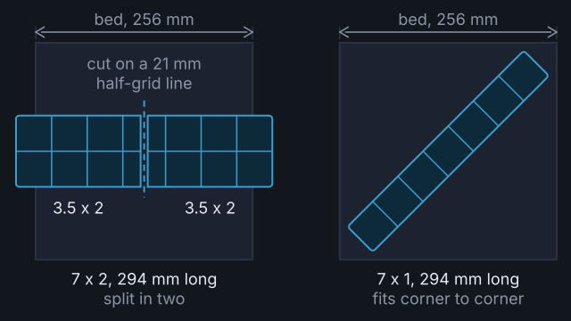
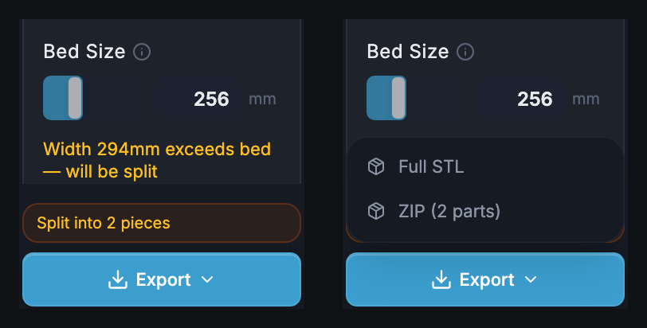

# Print a bin bigger than your printer bed

When a bin is longer or wider than your printer's bed, Tracefinity can cut it into pieces so you print one at a time. It needs your bed size, and the cuts follow the grid, so check where they land before you print.

## 1. Set your bed size

Set **Bed Size** in the bin sidebar, above **Partial Bins**, to the shorter side of your printer's build plate in mm. It goes from 150 to 500 mm and starts at 256 mm. If you print with a brim, take the brim's width off both sides.

New bins take their bed size from **Default Bed Size** under **Settings** (the gear icon, top right), unless their project has its own **Bin defaults**. Default Bed Size is kept in your browser, so set it again in another browser or on another computer. Bins you already have keep their own Bed Size.

## 2. Check where it splits

A bin too big for the bed is split. A long, narrow one may stay whole if it fits corner to corner. When it splits, **Split into 2 pieces** (or however many) appears above **Export**. The 3D preview shows the pieces in a row, one colour each.

- The cuts run straight down, on the 21 mm half-grid lines.
- Each side is cut into as few pieces as fit, as close to equal as 21 mm steps allow. A 7 x 2 bin on a 256 mm bed becomes two 3.5 x 2 pieces.
- A cut can run through the middle of a grid square, splitting its foot between two pieces.
- Pockets, labels and the stacking lip are cut with the bin. Nothing is added to join the pieces.

The note under **Bed Size** only compares each side with the bed. It can say a long, narrow bin will be split when it actually exports whole. A 7 x 1 bin is 294 mm long, but it fits corner to corner on a 256 mm bed and stays in one piece. Turn it 45 degrees in your slicer.

With **Partial Bins** on and **Connect base** off, a bin whose cells fall into separate groups exports as those groups. They are not cut to the bed. Turn on **Connect base** to have it split for the bed instead.

## 3. Export the pieces

Click **Export** and choose **ZIP (2 parts)** for one STL per piece. **Full STL** is the whole bin in one file, for a printer that can take it.

## 4. Print and join

Print each piece base down, the way it sits in the file. Stand the pieces side by side in your baseplate, which holds them in line. To lift the bin out in one go, glue the cut faces with a glue made for your filament. Hold them flat and square while it sets.

## Very long bins

The longest piece is your bed size rounded down to a multiple of 21 mm. Two pieces cover up to twice that:

| Bed Size | Longest piece | Two pieces cover |
|-|-|-|
| 180 mm | 168 mm | 8 units (336 mm) |
| 220 mm | 210 mm | 10 units (420 mm) |
| 256 mm | 252 mm | 12 units (504 mm) |

For a side longer than that, export the **Full STL** and cut it with your slicer's cut tool on lines between grid squares. Check that every piece fits your bed.

## Common mistakes

- **Leaving Bed Size at 256 mm on a smaller printer.** Pieces can come out up to 252 mm long.
- **Expecting old bins to follow Default Bed Size.** Change Bed Size in each bin.
- **Printing the Full STL by mistake.** It is the whole bin. The pieces are in the ZIP.
- **Expecting the contrast insert to split.** **Insert STL** is never split, so a long insert can still be too big for the bed.
