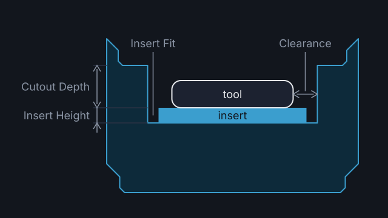
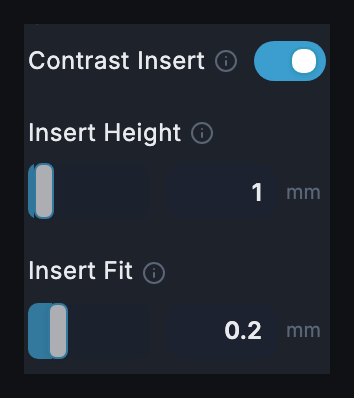

# Make a two-colour bin with a contrast insert

A contrast insert is a thin piece in a second colour that sits in the bottom of each pocket. Take a tool out and its shape shows in that colour, so you can see what is missing at a glance. Tracefinity makes the insert as its own STL and deepens the pockets to make room for it.

## 1. Turn it on

In the bin sidebar, turn on **Contrast Insert**. Two sliders appear:

- **Insert Height** is the insert's thickness: 0.5 to 10 mm, starting at 1.0 mm.
- **Insert Fit** is how much is taken off every edge of the insert so it drops in: 0 to 1 mm, starting at 0.2 mm.

Each pocket goes **Insert Height** deeper. So does each cutout's depth, including any **Depth** you have set on a tool or cutout. With the insert in place, the tool sits where it did before.

## 2. Leave room below the maximum

A pocket cannot go deeper than 7 mm per unit of **Height**, less 6.75 mm. If **Cutout Depth** plus **Insert Height** comes to more than that, the pocket stops at the limit and the tool sits higher than you set. In a 4u bin the limit is 21.25 mm, so with a 1 mm insert keep Cutout Depth at 20.25 mm or less, or raise **Height**.

## 3. Know what shape it is

The insert follows each pocket's outline, **Clearance** included, less Insert Fit on every side. With the defaults it is 0.8 mm bigger all round than the tool. A thin line of colour can show round the tool when it is in place. A hole in an outline, such as the inside of a ring spanner, comes out as a hole in the insert. Every pocket's insert is in the one STL.

The insert has no openings for cutouts. A cutout beside the tool works as before. But inside the outline, the insert covers any cutout you made deeper than the pocket, such as one to clear something under the tool.

## 4. Export and print

With the insert on, the **Export** menu lists **Full STL** for the bin, **Insert STL** for the insert, and a ZIP that holds both. The 3D preview draws the insert in orange.

Print the insert flat, as it comes out of the file, in your contrasting colour. Pick an **Insert Height** that is a whole number of layers: the default 1.0 mm is five 0.2 mm layers.

## 5. Fit it

Drop the insert into its pocket the way it printed, with the side that was on the bed facing down. Turned over, it is a mirror image and will not fit an outline that is not symmetrical.

- If it is tight, raise **Insert Fit**. Each 0.05 mm step makes the insert 0.1 mm smaller across.
- If it is loose, lower it.

Insert Fit changes only the insert, so you can reprint the insert on its own.

## Common mistakes

- **Changing Clearance after printing the insert.** The insert follows the pocket, so a new **Clearance** needs a new insert.
- **Labels on a pocket floor.** They sit on the deepened floor, under the insert. Put labels on the top surface.
