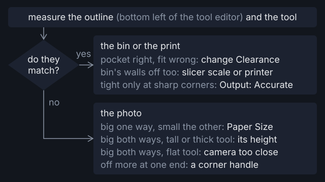
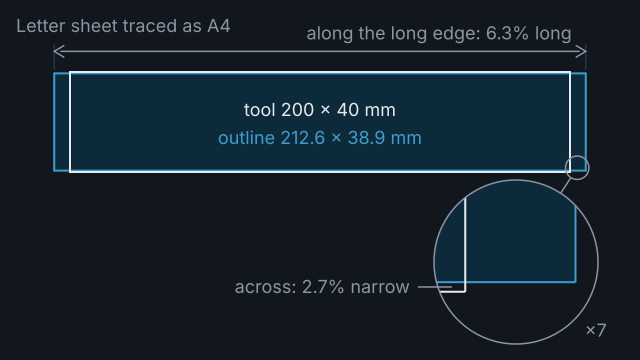

# Fix a cutout that comes out the wrong size

The pocket is the traced outline grown by the **Clearance** on every side, 1 mm by default. When a tool rattles or will not go in, either the outline is off or the bin and the print are. One measurement tells you which.

## 1. Measure the outline

Open the tool from your library. The bottom-left corner gives the outline's size, like 150.0x42.0 mm. That is the size of the box round it. If the outline sits at an angle, click **Auto** to square it up first. A bin holding the tool turns with it. Measure the tool with calipers or a ruler, the same way up. If they match, the photo is fine: go to step 3. If not, read on.

## 2. If the outline is off

| What you see | Cause | Fix |
|-|-|-|
| Too big one way, too small the other | Wrong **Paper Size** | Upload again with the right size |
| Too big both ways, on a tall or thick object | Its top is closer to the camera | [Trace tall or thick objects](tall-or-thick-objects.md) |
| Too big both ways, on a flat tool | Camera too close | Set the size from a measurement |
| Off more at one end than the other | A handle missed its corner | Upload again and place the handles exactly |

### Wrong paper size

Tracefinity stretches the sheet in your photo to the size you pick, so a wrong pick distorts the outline differently along and across the sheet. **Paper Size** starts on A4.

| Sheet you used | Size you picked | Along the long edge | Across |
|-|-|-|-|
| Letter | A4 | 6.3% long | 2.7% narrow |
| A4 | Letter | 5.9% short | 2.8% wide |
| Tabloid | A3 | 2.7% short | 6.3% wide |
| A3 | Tabloid | 2.8% long | 5.9% narrow |

A 200 mm spanner lying along a Letter sheet traced as A4 comes out about 213 mm long, with a 40 mm head about 1 mm too narrow. The **Size** fields cannot correct this because they scale both directions by the same amount.

### Camera too close

A flat tool's top edge also sits closer to the lens than the paper. From 30 cm, a spanner 6 mm thick traces about 2% large; from 60 cm, about 1%. Tracefinity warns when the photo's camera details put it closer than about 45 cm. With the tool under the camera, the error is roughly the same in every direction, so [set the size from a measurement](tall-or-thick-objects.md#4-measure-it-and-set-the-size). This does not need a new trace.

### A handle missed its corner

Each handle sets the scale near its corner. One 3 mm past the corner of an A4 sheet throws sizes out by 1 to 1.5% near that corner. The corners cannot be moved after the trace, so upload the photo again and zoom in on each corner as you place it.

## 3. If the outline is right

The pocket should be the outline plus twice the **Clearance**: a 150.0 mm outline with 1 mm of Clearance gives a 152 mm pocket. Measure a straight stretch of the printed pocket.

- Pocket right, fit wrong: change **Clearance** in the bin's sidebar. Each 0.1 mm adds 0.2 mm to the pocket. See [Get a snug fit](snug-fit.md).
- Pocket off: measure across the bin's walls. Each side should be 42 mm per grid unit less 0.5 mm, so 83.5 mm on a 2u side. If the outside is off by the same percentage, check the slicer's scale is 100%, then calibrate your printer. If only the pocket is small, your printer prints holes small: raise Clearance by half the shortfall.
- Tight only at sharp corners or tips: the smoothed outline rounds them. Set the tool to **Output: Accurate**, as in [Fix a trace](fix-a-trace.md).

## Common mistakes

- **Changing Clearance to fix a percentage error.** Clearance adds the same amount everywhere. A 3% error is 6 mm on a 200 mm spanner but under 1 mm on a 25 mm hex key.
- **Using the Size fields for a paper-size error.** They scale both directions equally, and this error is not equal.
- **Measuring the print first.** Without the outline's size you cannot tell the photo from the printer.
