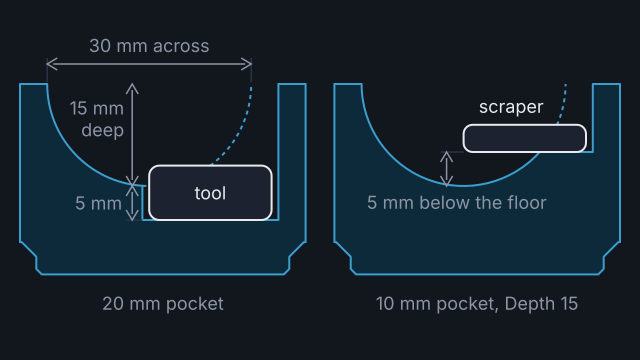
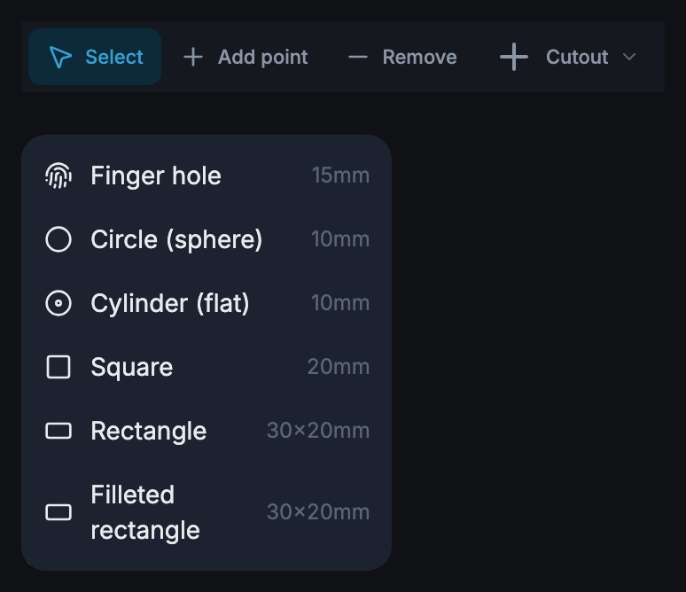
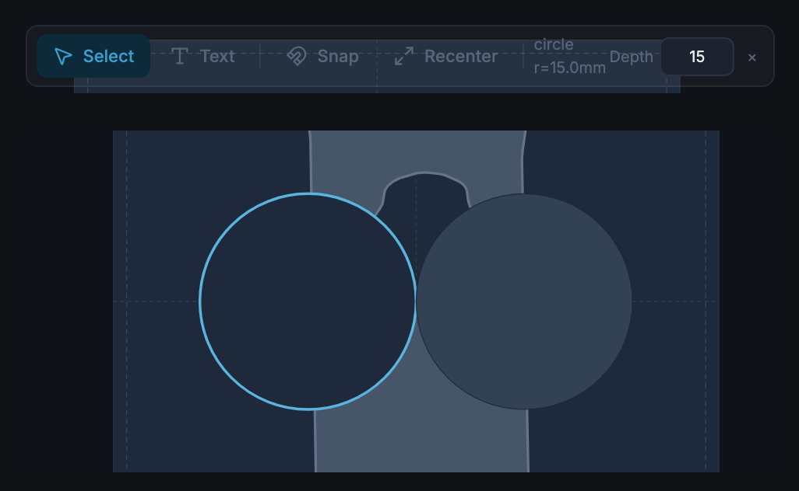

# Add finger holes so tools lift out

A tool that sits down in its pocket is hard to get hold of. A finger hole cuts a scoop beside it so you can reach the tool's edge and lift it out. Where you put the hole and how deep you make it decide whether it works.

## 1. Pick a cutout

Cutouts belong to the tool, so every bin with that tool gets them. Open the tool from your library, or select it in a bin and click **Edit**. In the toolbar, open the menu labelled **Cutout**.

| Cutout | Starts at | What it cuts |
|-|-|-|
| **Finger hole** | 15 mm radius | A round dish, as deep as its radius |
| **Circle (sphere)** | 10 mm radius | The same dish, smaller |
| **Cylinder (flat)** | 10 mm radius | A flat-floored round hole, full depth |
| **Square** | 20 mm sides | A flat-floored square hole, full depth |
| **Rectangle** | 30 x 20 mm | A flat-floored slot, full depth |
| **Filleted rectangle** | 30 x 20 mm | A full-depth slot whose floor curves up at two opposite sides |

Full depth means the pocket's depth, or the cutout's own depth if you set one (step 4).

## 2. Place it on the edge

Pick **Finger hole** and click the outline's edge where you would grip the tool, such as the middle of a screwdriver handle. Half the dish sits beside the tool and gives your finger room. A tool you pinch, like a tape measure, wants one on each side.

Every click adds a cutout, even a click on one that already exists. Switch to **Select** to drag a cutout, pull its handle to resize it, or remove it with **Delete**.

## 3. Make it deep enough

A dish is never deeper than its radius. The default finger hole is 30 mm across and 15 mm deep. In the default 20 mm pocket it stops 5 mm above the floor, so it only reaches tools thicker than that. For a thinner tool:

- Make the pocket shallower: select the tool in the bin and type a **Depth** in the toolbar.
- Or use **Cylinder (flat)**, which goes to the full depth without getting wider. A dish that reaches 25 mm down is 50 mm across.

## 4. Set the depth of one cutout

In the bin editor, click a cutout on a placed tool. The toolbar shows its shape and a **Depth** field. A finger hole shows as circle r=15.0mm. Leave the field blank to follow the pocket, or type a depth from 5 mm up to the bin's maximum and press Enter. The **x** beside it clears the value. These depths are saved with the bin.

A full-depth cutout goes to that depth. A dish goes to that depth or its radius, whichever is less, and narrows as it gets shallower. To get a fingertip under a flat tool like a scraper, set the cutout deeper than the pocket. In a 10 mm pocket, a finger hole with **Depth** 15 dips 5 mm below the floor at the tool's edge.

## 5. Keep clear of walls and neighbours

Cutouts are not held inside the bin, and **Auto-size grid** does not make room for them. Keep cutouts at least 1 mm inside the dashed line round the bin edge. Closer than that, they cut into the wall and stacking lip. Put finger holes on edges that face into the bin, or turn auto-size off, add a grid unit and click **Recenter**. A hole between two pockets opens into both and lowers the wall between them. Check the 3D preview.

## Common mistakes

- **A hole inside the outline.** Unless it is deeper than the pocket, it cuts nothing new. Centre it on the edge.
- **More depth on a dish.** Past its radius nothing changes. Drag it bigger, or use **Cylinder (flat)**.
- **Clicking a cutout to select it.** In a cutout mode, that adds a new one. Switch to **Select** first.
- **Rotating a tool in the bin.** Square and rectangular cutouts move with the tool but keep their angle. Round ones are not affected.
