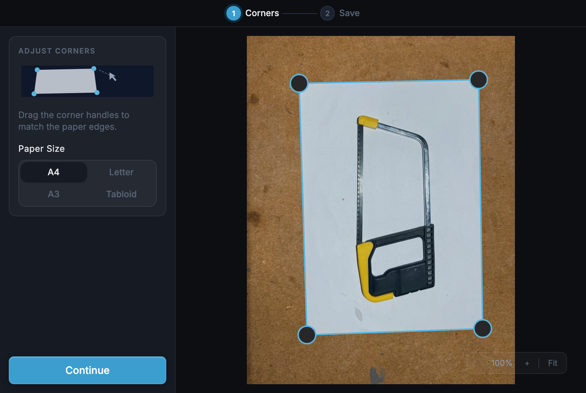
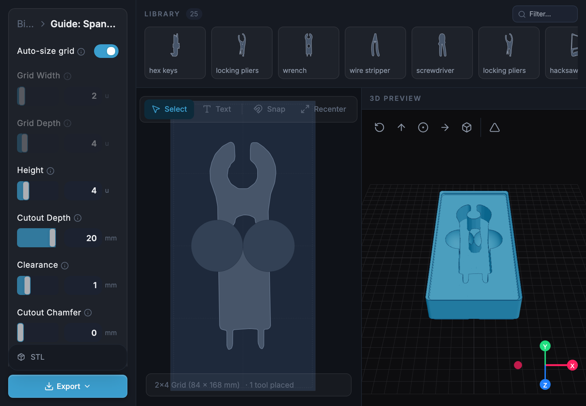

# Make your first bin from a photo

This takes one tool from a photo to a printed bin. Start with a flat tool like a spanner or a scraper. Thick tools need extra care with size, covered in [Trace tall or thick objects at the right size](tall-or-thick-objects.md).

You cannot change the corners or paper size after you click **Continue**, so check both first.

## 1. Take the photo

Lay the tool flat on a sheet of A4 or Letter paper, on a darker surface. Keep all four corners of the sheet in the shot. The tool can hang over an edge. Hold the phone level, at least 60 cm straight above the sheet, then zoom in until the sheet fills about half the frame's width. [Take a photo that traces accurately](take-a-photo-that-traces-well.md) covers light and backgrounds.

## 2. Upload it and set the corners

Click **Upload photo** and choose the picture. Tracefinity looks for the sheet and puts a handle on each corner. Zoom in with the **+** button and drag any handle that is not on its corner.

Under **Paper Size**, pick the sheet you used. It starts on **A4**, so change it if you used **Letter**.

Click **Continue**. What happens next depends on how many tracers your Tracefinity offers (see [Tracer backends](../usage/tracing.md#tracer-backends)):

- With one, such as Gemini on its own, the trace starts straight away.
- With several, such as the three local models offered by default, a **Trace** step opens. Pick one under **Tracer**, then click **Trace Tools**.

## 3. Keep the tool

The outline appears over a squared-up copy of your photo, listed as tool 1. Click the outline, or its row in the list, to select it. To rename it, click the pencil on the row, type a name and press Enter. Leave anything you do not want unselected, then click **Save 1 tool**. Tracefinity saves it to your library and takes you there.

With one tracer, leave **Re-trace** alone: it cannot trace this photo again ([#273](https://github.com/tracefinity/tracefinity/issues/273)). If you click it, reload the page to get your outline back. With several, **Re-trace** goes back to the Trace step, where you can trace the photo again with any of them.

If a warning appears in the sidebar, read it. It flags a camera that was too close, a sheet cut off at the edge, or a strong angle.

## 4. Check it in the tool editor

Click the tool in your library to open the editor. Your photo shows faintly behind the outline, so you can see whether the outline follows the tool. The bottom-left corner gives the outline's size in mm. Measure the tool with a ruler and compare.

If the outline strays, [fix the outline](fix-a-trace.md). If the size is off, [find out why](cutout-wrong-size.md). Edits save as you go and do not need a new trace. A bin that holds the tool picks up your edits the next time you open it.

## 5. Make a bin

In your library, hover over the tool and click the box icon, **Create bin**. Type a name and click **Create**. The bin opens with the tool in it and the grid sized to fit. The 3D preview rebuilds after every change.

The starting settings give a 4u high bin with a 20 mm deep pocket, 1 mm of **Clearance** round the tool, magnet holes and a stacking lip. To change the fit, see [Get a snug fit](snug-fit.md). To give your fingers room to lift the tool out, [add a finger hole](finger-holes.md).

## 6. Export and print

When the preview has finished, click **Export**, then **STL**.

Print the bin base down, with no supports. The [print recommendations](../usage/exporting.md#print-recommendations) cover layer height, infill and material.

## Common mistakes

- **Leaving the paper size on A4 for a Letter sheet.** The outline comes out about 6% too long along the sheet's long edge and 3% too narrow across it.
- **Shooting from close up.** From 30 cm, a spanner 6 mm thick traces about 2% large. Stand back and zoom in.
- **Clicking Continue with a handle off its corner.** Fixing it means uploading the photo again and tracing it again.
- **Printing before checking the size.** Compare the outline with the tool first. A reprint costs filament as well as time.
