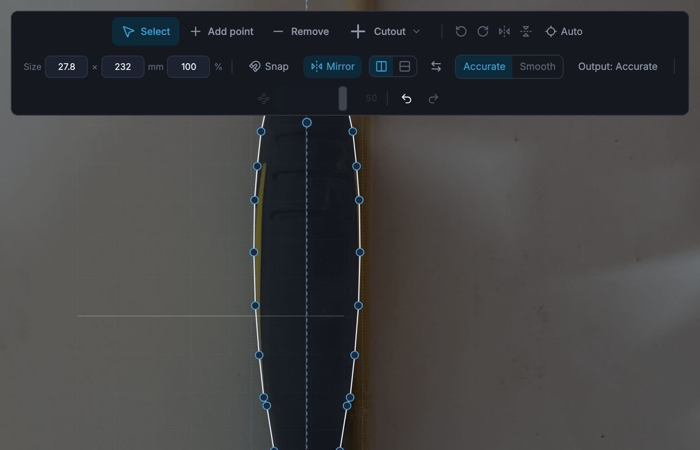

# Fix a trace that's slightly off

Most outline faults are quicker to fix in the tool editor than to trace again, and edits do not need a new trace. Open the tool from your library; your photo shows behind the outline.

Scroll to zoom, and Ctrl+Z undoes. Changes save as you go.

## A thin part is missing

The trace can lose a thin blade, a jaw tip or a narrow handle. Click **Add point**; a green dot marks the middle of each edge. Click the edge where the missing part starts, then drag the new point out along the part. Add more until the outline follows the tool in the photo.

## The outline bulges into a shadow

In **Select** mode, drag the bulge's points back to the tool's edge, or click **Remove** and click the points you do not need. If the bulge has dozens of points, first drag the slider with the point count beside it to the left. It thins the whole outline, so stop while the rest still follows the tool.

### Mirror a symmetric tool

A screwdriver, scraper or squeegee is the same either side of its centre line, so you can copy the clean half over the shadowed one. Mirror copies the left half, so line the tool up first.

1. Click **Auto**, which lays the long side across the screen, then a rotate 90 degrees button so the centre line runs up and down.
2. If the clean half is on the right, click the flip-horizontally button.
3. Click **Mirror**. The left half is copied onto the right, about a dashed axis through the middle.
4. Drag the round handle at the top of the axis until the outline matches the tool in the photo. The copy is redone each time you let go.
5. Any point you move, add or remove is matched on the other side, and new cutouts are mirrored.
6. Click **Mirror** again to finish. The outline stays mirrored.

The axis and swap buttons beside Mirror work on the outline as it now is, so they cannot restore a replaced half; press Ctrl+Z instead. Holes inside the outline are not mirrored, and the Detail slider is off while Mirror is on.

## A hole where the tool is solid

A hole in the outline leaves an island of plastic in the pocket. A hole where the tool is solid, like one left by a bright reflection, stops the tool going in. Click **Fill in**, then click the hole, which turns green under the pointer. The button only appears when the outline has holes.

Leave holes that match a real gap, like the inside of a hacksaw frame. If a real gap came out filled, the pocket is open there and the tool still fits.

## Ragged edges or rounded corners

New tools print from the smoothed outline: the button reads **Output: Smooth**. Smoothing evens out small wobbles but rounds sharp corners. Click **Smooth** to see it and drag the slider that appears for more or less: bins use that setting while the output is Smooth. For crisp corners, as on a speed square, click the button so it reads **Output: Accurate**. The **Accurate** and **Smooth** buttons only change the view.

## When to trace again

- Two tools came out as one outline. The editor cannot split it, so move the tools apart and take a new photo.
- The whole outline is off because of the wrong paper size or a misplaced corner handle. See [Fix a cutout that comes out the wrong size](cutout-wrong-size.md).
- Large parts are missing because of the photo. See [Trace shiny, chrome or black tools](shiny-or-dark-tools.md) and [Trace small or thin tools](small-or-thin-tools.md).

Each of these means uploading a photo and tracing it again. With several tracers, **Re-trace** lets you trace the same photo again with another one, which can help when parts are missing.

## Common mistakes

- **Editing in the Smooth view.** Points can only be moved, added or removed in the Accurate view.
- **Clicking Mirror before lining the tool up.** Press Ctrl+Z, click **Mirror** to switch it off, rotate or flip, then click **Mirror** again.
- **Expecting the view to change the print.** The **Accurate** and **Smooth** buttons only change the view. The Output button changes the bin, and so does the Smooth slider while the output is Smooth.
