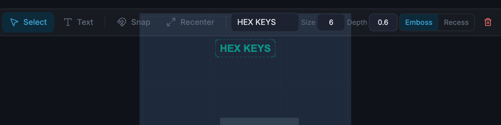

# Label a bin

Text labels are raised from the bin or cut into it, on the top surface or on a pocket's floor. Raised labels also export as a body of their own, so you can print them in a second colour.

## 1. Place a label

1. In the bin editor, click **Text** in the floating toolbar.
2. Click where the label goes. Click inside a tool's outline to put it on that pocket's floor.
3. Type the text and press Enter. Escape cancels.

The label is centred on the point you clicked. Double-click it to change the text. Drag it to move it, or drag a corner of its selection box to rotate it. A label stays on the side of a pocket's edge it started on, so you cannot drag one from the top surface into a pocket.

## 2. Set size, depth and style

Select a label and the toolbar shows its text, then:

- **Size** is the font size in mm, 1 to 50. New labels start at 5 mm. Capital letters come out about two-thirds of the size: about 3.3 mm tall at 5 mm.
- **Depth** is how far the text rises or sinks, 0.1 to 5 mm, starting at 0.5 mm.
- **Emboss** raises the text and **Recess** cuts it in. New labels are embossed.

The 3D preview shows the lettering as it will print.

## 3. Keep labels where they will print

- A label in a pocket sits at the bin's **Cutout Depth**. If that tool has its own **Depth**, the label misses the floor, so clear the tool's Depth or move the label to the top surface.
- With **Contrast Insert** on, the insert covers pocket floors. Put labels on the top surface.
- Keep labels well inside the dashed line near the bin edge, clear of the walls.
- Labels in cells switched off with **Partial Bins** are left out.

## 4. Print it in a second colour

The STL always has the text joined to the bin, for one-colour printing. When the bin has at least one **Emboss** label, the **Export** menu also lists **3MF**. It holds two bodies, the bin and the text, already in place.

With a printer that takes more than one filament:

1. Open the 3MF in your slicer.
2. The file holds two objects. When the slicer offers to load them as one object with several parts, accept, or merge them yourself. If they stay as two objects, most slicers drop the text onto the bed.
3. Give the text part your second filament.

With one filament, have the slicer pause for a colour change at the right layer instead. Everything above the change prints in the new colour, the stacking lip included. The top surface is at 7 mm per unit of **Height**: 28 mm in a 4u bin.

- For raised text on the top surface, change at the first layer of the text.
- For recessed text, change at the first layer above the bottom of the letters. The surface prints in the new colour and the letters show the old one.

Make **Depth** a whole number of layers, such as 0.6 mm for 0.2 mm layers. The default 0.5 mm falls between them.

## Common mistakes

- **Expecting a 3MF from recessed labels.** Only **Emboss** labels make one. Recessed text needs a colour change.
- **Small text in a second colour.** Thin strokes break up. Make the label bigger.
- **Raised text on a bin you stack.** With **Raise Lip** at 0, a bin stacked on top rests its feet on the top surface, so raised text there lifts it. Recess it instead.
