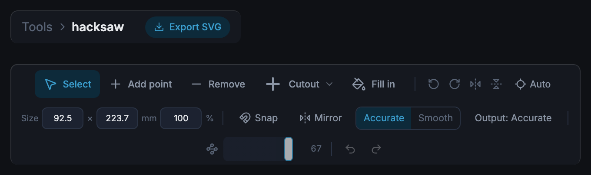
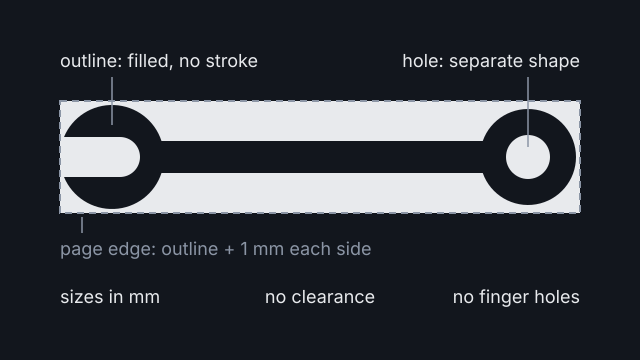

# Use outlines for laser cutting, CNC and foam

You can download any tool in your library as an SVG outline. Use it on a laser cutter or a CNC router, or print it as a paper template for cutting foam by hand. The outline is the tool's own size, with no clearance and no cutouts. You add those in your design software.

## 1. Get the outline right first

The SVG uses the same outline as your bins. The toolbar button that reads **Output: Accurate** or **Output: Smooth** picks which one. Changes you make to the outline, such as **Size**, rotating and flipping, come with it.

Holes inside the outline, like the window in a speed square, come out as separate shapes. To drop one, click **Fill in** in the toolbar, then the hole. The button only appears on tools that have holes.

Once the tool has finished saving, click **Export SVG** next to its name. The file is named after the tool.

## 2. Know what is in the file

| Part | What you get |
|-|-|
| Units | Millimetres. One unit in the file is 1 mm. |
| Page | The outline plus a 1 mm margin on every side. |
| Outline | One closed shape, filled black, with no stroke. |
| Holes | Closed shapes filled white, on top of the outline. |
| Clearance | None. The bin's **Clearance** is not applied. |
| Cutouts | None. Finger holes and other cutouts only exist as bin pockets. |

The outline faces the way it does in the editor, seen from above. It is not mirrored.

## 3. Import it at full size

Open or import the file at 100%, in software that reads the document's units. Check one dimension. The outline should match the **Size** fields in the tool editor to within about a millimetre, and the page should be about 2 mm bigger each way. If it is far out, the software has ignored the units. Import it again with the units set to millimetres.

The shapes are filled, with no stroke. Set them to cut in your laser or CAM software. Some programs treat a filled shape as an area to engrave, or only cut shapes that have a stroke, until you change it.

## 4. Add clearance and allow for the cutter

Offset the outline outwards by the clearance you want. Bins use 1 mm by default.

On a CNC router, keep the cutter inside the line for a hole or pocket. A round bit cannot cut a sharp inside corner, so the corners of the hole come out rounded to the bit's radius. Sharp tips on the tool may not drop in. Use a smaller bit or more clearance there.

For a foam insert, cut the outline through a sheet as thick as you want the pocket and glue it onto an uncut sheet underneath. To cut foam by hand, print the SVG at 100%, check it with a ruler and cut round it. Before laser cutting anything, check the material is safe to laser cut. Never laser cut PVC or vinyl.

## Common mistakes

- **Cutting at the tool's own size.** The file has no clearance, so the tool may not drop in. Offset it first.
- **Expecting finger holes.** Draw a finger notch into the outline in your software.
- **Exporting before it saves.** While the label by the name reads **Saving...**, the download is the outline from before your last change.
- **Letting the software rescale it.** Import at 100% and check against the Size fields.
- **A name with unusual characters.** If **Export SVG** fails, rename the tool using plain letters and digits, then export again.
