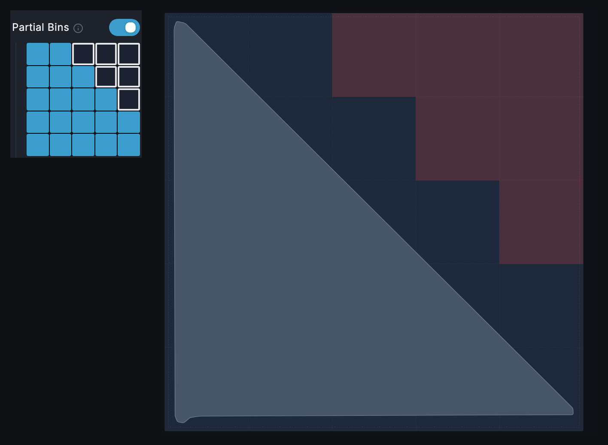
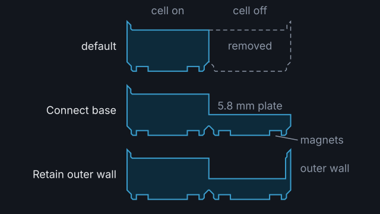

# Save filament with partial bins

A bin covers a rectangle of grid cells, but your tools may not fill them. Partial bins let you switch cells off. A switched-off cell is left out entirely: no wall, floor or base. That saves filament and frees the cell on your baseplate for another bin. It helps most when the layout leaves a corner empty, such as beside the long edge of a speed square.

## 1. Finish the layout first

Anything that changes the grid size switches every cell back on. That includes adding a tool, moving the **Grid Width** or **Grid Depth** slider, or, with **Auto-size grid** on, moving a tool or changing **Clearance**. Place and arrange your tools, then switch cells off. To hold the size while you work, turn **Auto-size grid** off.

Auto-size also keeps the layout centred in the smallest grid that fits. So empty cells only turn up in gaps the layout leaves, like a free corner.

## 2. Switch cells off

1. In the bin sidebar, turn on **Partial Bins**. A grid appears with one square per cell. A half unit counts as a cell.
2. Click a square to switch that cell off, and again to switch it back on. The last cell cannot be switched off.
3. The canvas tints switched-off cells red. Check the 3D preview for what will print. When the grid has a half unit, go by the preview alone: the tint can be missing or in the wrong place.

Tracefinity does not check what you switch off, and labels in a switched-off cell are dropped.

## 3. Choose how the rest prints

By default the switched-off cells are cut away. If the cells left form separate groups, each prints as its own piece. With two groups, the sidebar shows **Split into 2 pieces** and the **Export** menu offers **Full STL** and **ZIP (2 parts)**, one STL per piece.

**Connect base** removes the walls in switched-off cells and bridges them with a thin plate, so the cells you keep stay joined. It saves less filament, and those cells still take up the baseplate.

**Retain outer wall**, which appears once Connect base is on, keeps the bin's outer wall running through the switched-off cells.

## 4. Splitting and drawer plans

Without Connect base, Tracefinity checks the bin against your **Bed Size** using only the span of the cells left on. With Connect base, it uses the full grid. The warning under Bed Size always measures the full grid, so go by the split banner at the foot of the sidebar instead.

The drawer planner places every bin by its full rectangle. A bin you set into the freed cells shows as overlapping, even though it fits on the real baseplate.

## Common mistakes

- **Switching cells off before the layout is done.** The next change to the grid size switches them all back on.
- **Cutting into a pocket.** A switched-off cell takes any part of a pocket inside it with it. The pocket is the outline plus **Clearance**, and cutouts stick out past it, so keep every cell they reach.
- **Turning Partial Bins off to compare.** That also switches **Connect base** and **Retain outer wall** off, and they stay off when you turn it back on. Your cell pattern is kept.
