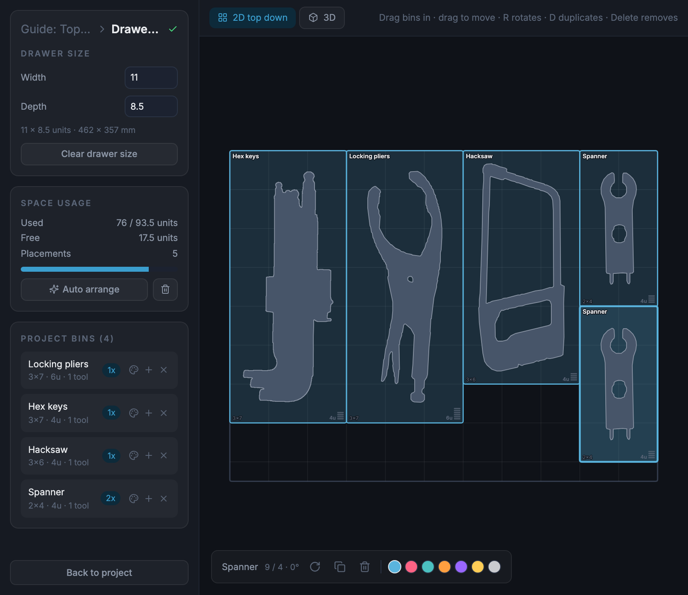
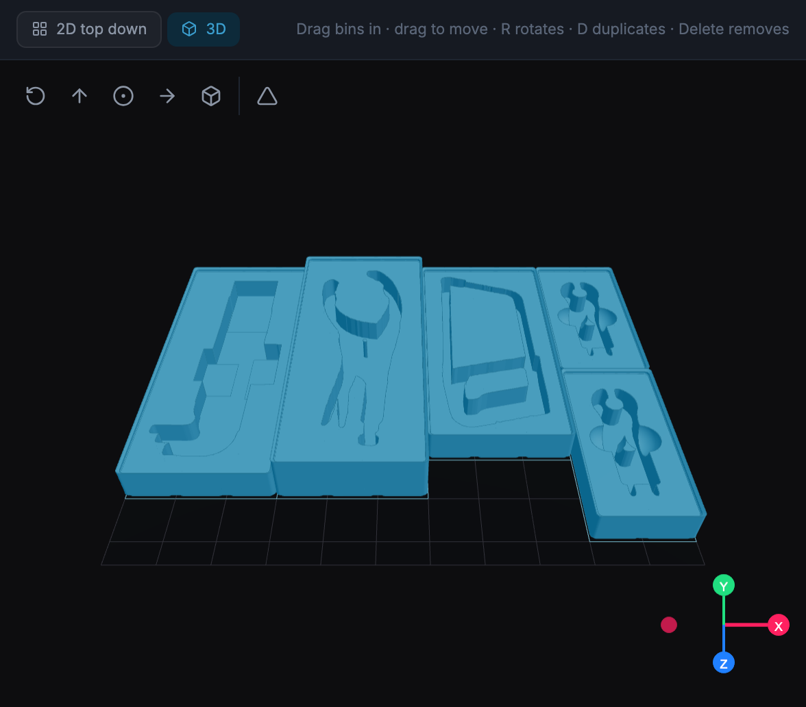

# Plan a whole drawer

A drawer plan lays a project's bins out on a grid the size of your drawer. You can see what fits before you print anything. The bins belong to the project. The plan only places them, and one bin can be placed as many times as you need.

## 1. Measure the drawer

Measure the inside width and depth at the narrowest point, past any lip or runner. Divide each by 42 mm (the size of a grid unit) and round down to the nearest half. A drawer 470 x 360 mm inside is 11 x 8.5 units.

## 2. Make the project and its bins

1. On the app's home page, click **New project** in **Projects**, name it after the drawer and click **Create**.
2. Under **Add tools**, tick the tools for this drawer and click **Add**.
3. To give the project's bins shared settings such as **Height**, open **Bin defaults**, set them and click **Save defaults**.
4. In **Project tools**, tick the tools for one bin and click **Create bin** at the top of the page. Newly added tools start ticked.
5. The bin editor opens with the tools on top of each other in the middle. Drag them apart. With **Auto-size grid** on, the bin grows to fit.
6. Click **Projects** in the breadcrumb to go back, and repeat for each bin.

## 3. Set the drawer size

Under **Drawer plans**, click **New plan**, then **Set drawer size**. Type the **Width** and **Depth** in units, from 1 to 40 in whole or half units. The line underneath gives the size in mm, which should be no more than you measured.

## 4. Place the bins

- Drag a bin from **Project bins** onto the grid, or click its **+** to drop a copy in the first free spot.
- Drag placed bins to move them. They snap to whole units, or to half units if the bin has **Half-grid base** on for a 21 mm baseplate.
- Select a bin, then press **R** to turn it 90 degrees, **D** to duplicate it or **Delete** to take it out. The bar at the bottom has the same buttons.
- **Auto arrange** repacks the bins you have placed, largest first, turning one 90 degrees when that is the only way it fits. In an empty plan it places one of each.

The count next to each bin in the list is how many copies are placed. Print each bin that many times.

## 5. Check the warnings and the 3D view

A bin that overlaps another turns red with a dashed outline. One that hangs out of the drawer turns amber, also dashed. **Space usage** counts both, with the units used and free. Anything **Auto arrange** could not fit keeps its old spot and shows the same dashed outline.

Click **3D** above the plan to see the real bin models, pockets and heights. A bin shows as a see-through block until its model has generated. The bars in the corner of each bin in the 2D view count its **Height** only, so check Raise Lip in 3D. There is no drawer height setting. Compare the drawer with your tallest bin's height in the bin editor's **Dimensions** panel, plus any height your baseplate adds.

## Common mistakes

- **Rounding up.** A drawer 10.7 units wide holds 10.5 units of bins, not 11.
- **Typing a size like 10.3.** The plan only saves whole and half units. A red warning in the sidebar says your changes are not being saved.
- **Clicking Clear drawer size to resize.** It takes out every placement too. Type the new size instead.
- **Treating a copy as a separate bin.** Every copy is the same bin, so editing it changes them all. Make a second bin for a variation.
