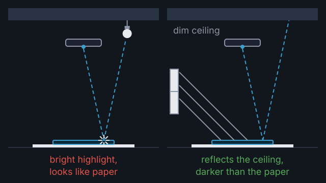
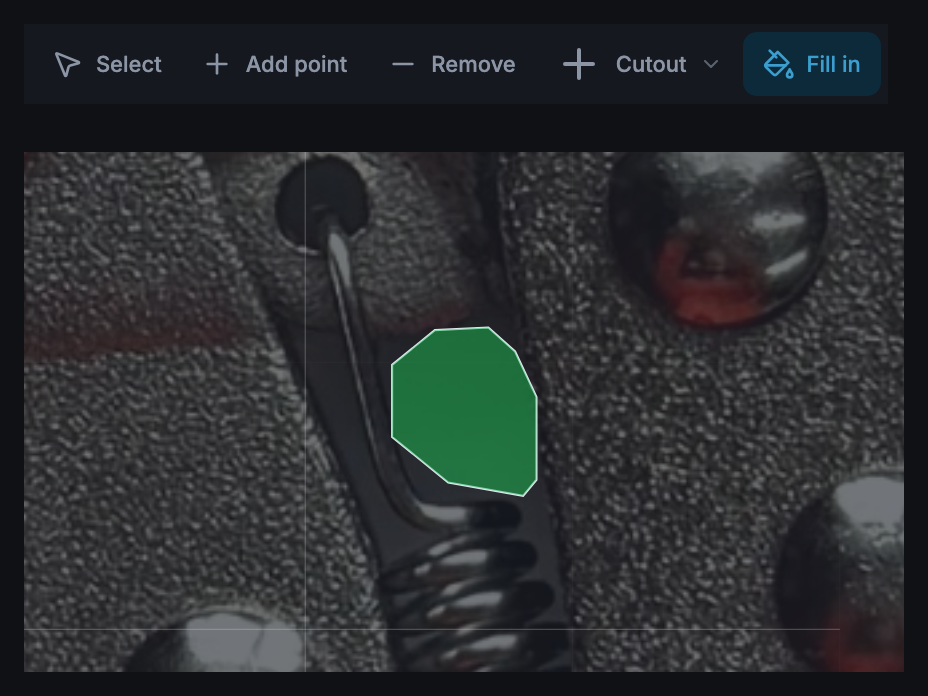

# Trace shiny, chrome or black tools

Tracefinity finds a tool by how different it looks from the white sheet. Three kinds of tool make that hard. Chrome and polished steel are mirrors: they reflect the lights above and the sheet around them, so patches can look as white as the paper. Black tools stand out on white, but so do their shadows, and they blend into a dark surface. White and pale objects barely differ from the paper at all.

Most of the fix is in the setup. Get the light and background right before you trace. The basics are in [Take a photo that traces accurately](take-a-photo-that-traces-well.md).

## 1. Light chrome with a big, soft source

A flat polished face mirrors whatever is directly above it back into the camera. Under a bare bulb, that is a white highlight the tracer can mistake for paper. With soft light from the side, the face mirrors a dim ceiling and reads darker than the sheet.

- Light the tool from a window, or bounce a lamp off a white wall.
- Keep bare bulbs and spotlights out of the space directly above the tool.
- Turn the flash off.

## 2. Keep black tools on the sheet

Soft light matters for black tools too. A hard shadow is as dark as the tool and can be traced as part of it.

The sheet needs a surround darker than itself, but a black tool on a black surface has no edge to find. Keep dark tools fully on the sheet, using A3 or Tabloid if they do not fit on A4. If one has to hang off, put the sheet on plain mid-tone wood instead.

## 3. Shade pale objects from one side

A white or pale object on white paper shows its edges mainly where it is shaded. Light it from one side, with a window beside the table rather than a lamp above it. The side away from the light then falls into soft shade. If the trace picks up some of the shadow, trim it afterwards.

## 4. Check the trace

Before you save, compare each outline with the photo. Then look at the mask preview under the tool list: black marks what was traced as tool. Look for:

- bites out of an edge where a highlight looked like paper
- holes inside the outline where the tool is solid
- bulges where a shadow was traced
- a dark tool cut short where it runs onto a dark surface

## 5. Fix the outline

Save the tool, open it from your library and fix the outline there. This needs no new trace.

Tracefinity fills holes smaller than about 7 mm across on its own. A bigger one stays, and prints as a post in the pocket that stops the tool sitting down. Click **Fill in** in the toolbar, then click the hole. **Fill in** only appears when the outline has a hole.

For bites and bulges, drag or add points: see [Fix a trace that's slightly off](fix-a-trace.md). Only retake when a large part of the tool is missing.

## Common mistakes

- **Shooting chrome under a ceiling bulb.** Move to window light, or bounce a lamp off a wall.
- **Using the flash.** It puts a hard highlight on every polished face that points at the camera.
- **Letting a black tool hang off onto a black mat.** Keep it on the sheet or use a mid-tone surface.
- **Leaving a hole in the outline.** It prints as a post in the pocket. Use **Fill in**.
