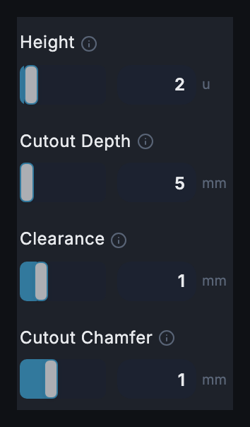

# Get a snug fit

A pocket is your traced outline grown by **Clearance** on every side. If the outline is off, or Clearance does not suit your printer, the tool rattles or will not go in. Check the outline on paper first, then set Clearance from a shallow test print.

## 1. Know what Clearance does

**Clearance** is in the bin sidebar. It applies to every pocket in that bin. The default is 1.0 mm, which makes each pocket 2 mm longer and 2 mm wider than its outline. The slider runs from 0 to 5 mm in 0.1 mm steps. Each step changes the pocket by 0.2 mm across. Cutouts keep their drawn size.

The play you feel is twice the sum of Clearance and any error in the outline, less what your printer takes off. Printed pockets tend to come out a little small. A spanner traced 0.5 mm too big all round has 1.5 mm per side at the default Clearance: 3 mm of play.

## 2. Check the outline on paper

1. Open the tool and click **Export SVG** at the top left of the page.
2. Print the file at 100% or actual size, not fit to page. The SVG is drawn in millimetres at full size.
3. Measure the black shape. It should match the **Size** fields in the tool editor toolbar. A few percent out means the printer scaled it.
4. Lay the tool on the shape, the way up it will sit in the pocket. Its edge should follow the black all the way round.

The SVG is the exact shape the pocket starts from before Clearance is added. It follows the tool's **Output: Smooth** or **Output: Accurate** setting. It leaves out cutouts. If black shows round the tool, or the tool overhangs, fix the outline before you touch Clearance ([fix a trace](fix-a-trace.md), [fix the size](cutout-wrong-size.md)). This check suits tools that fit on one sheet.

## 3. Print a shallow test

Set **Height** to 2 and **Cutout Depth** to 5 mm, its lowest setting. The pocket walls are straight. A tool that fits 5 mm deep fits the same at 20 mm, as long as it is widest within 5 mm of its underside. For a round handle, go by the caliper measurement rather than whether it drops in. The bin is 14 mm to its top surface, not 28 mm. A 1u bin is no use for this: it only has room for a 0.25 mm pocket.

Export the STL, print it and drop the tool in. Measure the pocket with the inside jaws of a caliper and the tool with the outside jaws. The difference is the play.

## 4. Set Clearance from the test

- If it is loose, lower Clearance by half the play you want to lose. A screwdriver with 1.6 mm of play keeps 0.6 mm when Clearance drops from 1.0 to 0.5 mm.
- If it is tight, raise Clearance by half the extra room the tool needs.
- If one tool is off and the rest fit, that outline is wrong. Go back to step 2.

With **Auto-size grid** on, more Clearance can push the bin up a grid unit.

## 5. Add a lead-in

**Cutout Chamfer** bevels the top edge of every pocket and cutout, up to 3 mm. At 1 mm the bevel runs 1 mm down. It widens the mouth by up to 1 mm at the outline's outer edges, and less towards the middle: about 0.2 mm beside a screwdriver shaft. It helps the tool find its way in. The fit below the bevel does not change.

## Common mistakes

- **Changing Clearance to fix one tool.** It loosens every pocket in the bin. Fix that tool's outline instead.
- **Printing the SVG to fit the page.** The shape is rescaled, often larger. Print at 100% and measure it.
- **Exporting with the test settings.** Lowering **Height** pulls **Cutout Depth** down with it, and raising Height does not put it back. Set both again before the final export.
- **Low Clearance on a smoothed outline.** Smoothing rounds sharp corners off by a few tenths of a millimetre, so a square-cornered tool can bind there. Switch that tool to **Output: Accurate**.
