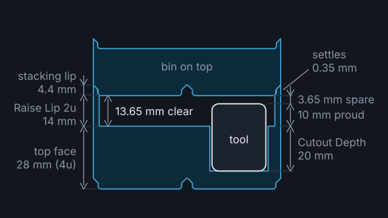
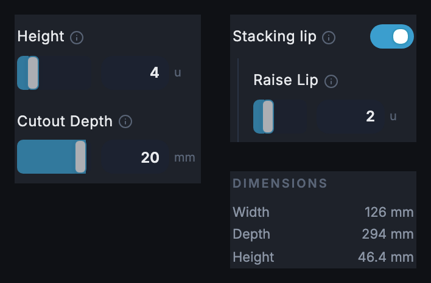

# Stack bins over tools taller than their pocket

A tool thicker than its pocket sticks out of the top of the bin. Stack another bin on top and it comes down on the tool. A stacked bin rests on the flat top face of the bin below. The stacking lip only holds it in place.

**Raise Lip** builds the walls and stacking lip higher in 7 mm steps and leaves the inside open. The bin on top sits higher and clears the tool.

## 1. Work out how far it sticks out

The top face is the flat surface the pockets are cut into. It sits 7 mm up for each unit of **Height**, so 28 mm up in a 4u bin.

Measure the tool at its thickest point, lying the way it sits in the bin. Take away the pocket depth: **Cutout Depth** in the sidebar, or the **Depth** you gave that tool in the bin editor toolbar. Locking pliers 30 mm thick in a 20 mm pocket stick out 10 mm.

A pocket can go down to 6.75 mm above the bottom of the bin, which keeps the base and a 2 mm floor. So **Cutout Depth** goes up to 21.25 mm in a 4u bin. To bury the tool in a deeper pocket instead, see [make the pocket deep enough](tall-or-thick-objects.md#5-make-the-pocket-deep-enough). Raise Lip is for a tool you would rather leave sticking out, where you can grab it.

## 2. Set Raise Lip

Keep **Stacking lip** on and **Raise Lip** appears under it, from 0 to 10u. Each unit adds 7 mm of wall. The bin on top settles 0.35 mm into the raised wall, so the clear space is 7 mm per unit, less 0.35 mm.

| Raise Lip | Clear space above the top face |
|-|-|
| 1u | 6.65 mm |
| 2u | 13.65 mm |
| 3u | 20.65 mm |
| 4u | 27.65 mm |

Pick the first row that clears the tool by at least 1 mm. The pliers sticking out 10 mm need 2u, which leaves 3.65 mm to spare.

Raise Lip leaves the pockets alone. They are still cut down from the top face, and **Cutout Depth** keeps the same maximum.

## 3. Check the height

The **Dimensions** panel below the settings shows the bin's full height, including the raised lip. That is 7 mm for each unit of **Height** and **Raise Lip**, plus 4.4 mm of stacking lip. A 4u bin with 2u of Raise Lip is 46.4 mm tall. Check the stack still fits your drawer, with your baseplate under it.

## 4. Stack a bin the same size

The bin on top needs the same **Grid Width** and **Grid Depth**, so its feet sit in the lip all the way round. A smaller bin is not held by the lip and can drop into the open space inside the raised wall.

## Common mistakes

- **Turning off Stacking lip.** Raise Lip resets to 0 and disappears. Turn the lip back on and set it again.
- **Raising Height on its own.** Pockets are cut down from the top face. A taller bin with the same Cutout Depth leaves the tool sticking out just as far.
- **Counting the stacking lip as room.** With Raise Lip at 0 the bin on top rests on the top face, and its feet fill the lip.
- **Measuring from the top of the lip.** The clear space in the table starts at the top face, where the pockets begin.
