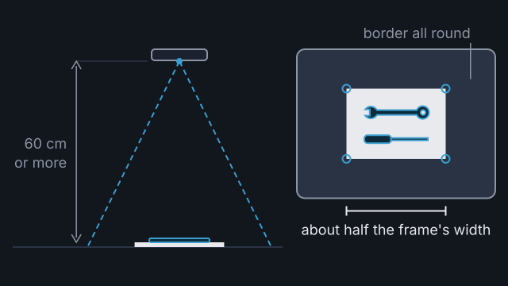
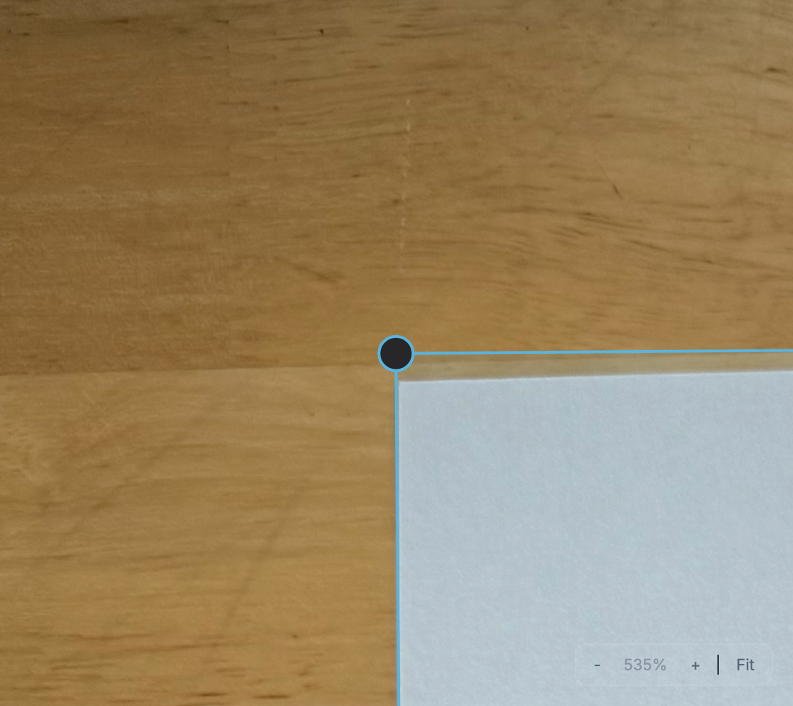

# Take a photo that traces accurately

Tracefinity gets its scale from the sheet of paper and finds each tool by how it stands out from the sheet. Get either wrong and the pocket rattles or pinches.

Tracefinity checks the photo when you press **Continue** after placing the corners. A retake means a new upload and a new trace, so set up first.

## 1. Choose the sheet

Use plain white printer paper, flat and unfolded. A4 or Letter works for most hand tools. For saws and levels, see [Trace tools longer than the sheet](tools-longer-than-the-sheet.md). Note which size you used, because every measurement comes from it.

## 2. Put it on a darker surface

Tracefinity looks for a bright sheet against a darker background. Plain mid or dark wood, a dark worktop or dark card all work. On a white or pale table the corners can land off the paper.

## 3. Light it evenly

Use daylight or room light with the flash off. Flash glares on metal. Keep your shadow and the phone's off the sheet. A shadow across the sheet can pull a corner inside the paper, which stretches the trace. A hard shadow beside a tool can be traced as part of it.

## 4. Lay out the tools

Lay each tool flat, at least 1 cm from the next. Tools that touch trace as one outline. Tools can hang over the edge of the sheet, but keep all four corners uncovered. For thick tools, see [Trace tall or thick objects at the right size](tall-or-thick-objects.md).

## 5. Take the photo

1. Stand over the sheet and hold the phone flat, directly above the middle.
2. Hold it at least 60 cm above the sheet.
3. Zoom in (2x or 3x on most phones) until the sheet fills about half the frame's width.
4. Check that all four corners are in the frame, with background showing round the sheet.

From off to one side, the camera also sees one side of a thick tool, and the outline includes it. A tool 15 mm thick seen 10 degrees off vertical gains 2.6 mm. Tracefinity does not warn about an angle that small.

Upload the photo as the camera saved it. A screenshot, or a cropped or resized copy, skips the distance check.

## 6. Check the corners and the paper size

Tracefinity puts a handle on each corner of the sheet it finds. If it finds none, the handles start a little inside the corners of the photo. Zoom in with the **+** button and drag each handle onto a corner of the paper. Pick the **Paper Size** you used (it starts on A4), then press **Continue**.

## What the warnings mean

| Warning | Cause | Next time |
|-|-|-|
| Camera looks about 30 cm from the paper | The camera looks under 45 cm from the sheet | Stand back to 60 cm or more and zoom in |
| The paper looks cut off at the photo edge | A corner of the sheet is at the edge of the photo | Leave a border round the sheet |
| Strong camera angle detected | One side of the sheet looks over 35% longer than the opposite side | Shoot from directly above |

Warnings are advice, and **Dismiss** hides them. With one tracer, the trace starts at the same time. With several, they appear before you click **Trace Tools**. Retake only when a warning matters for this tool: distance for thick tools, a cut-off corner for the scale.

## Common mistakes

- **Leaving Paper Size on A4 for Letter paper.** A 200 mm spanner along the sheet's long side traces about 12.6 mm too long.
- **Picking A4 for an A3 sheet.** Everything traces 29% small.
- **Getting close instead of zooming.** At 30 cm a tool 15 mm thick traces about 5% large.
