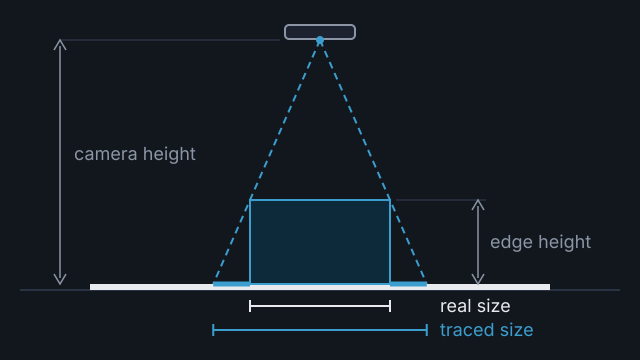
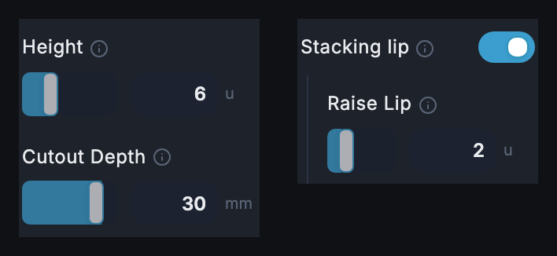

# Trace tall or thick objects at the right size

Tracefinity sets the scale from the sheet of paper, which lies flat on the table. Anything above the sheet is closer to the camera, so it looks bigger than it really is. For a spanner the difference is small. For a tape measure, a multimeter or a boxed kit it can be enough that the tool rattles in its pocket.

## 1. Work out whether it matters

The outline Tracefinity traces is the widest edge the camera can see. On a tall object that edge is the top. It traces too large by roughly its height above the paper divided by the camera's height above that edge.

| Edge above the paper | From 30 cm | From 60 cm | From 1.5 m |
|-|-|-|-|
| 15 mm | 5% | 2.5% | 1% |
| 40 mm | 15% | 7% | 3% |
| 75 mm | 33% | 14% | 5% |

A 150 mm multimeter on its back, with its outline 40 mm up, comes out about 11 mm too long from 60 cm. If your object's error is a millimetre or less, the [usual photo setup](take-a-photo-that-traces-well.md) is enough.

Tracefinity warns when the camera is very close, but it cannot see how tall your object is. A photo can pass with no warning and still trace large.

## 2. Lay it on its flattest side

Put the object down the way that keeps its widest edge lowest. A multimeter lies on its back, a tape measure on its side. The pocket takes the shape of the pose you photograph, so pick the way you want the object to sit in the bin.

The sheet is only there for scale. A long object can hang over the edge. There is no need to stand it up to fit.

## 3. Shoot from further away and zoom in

Distance shrinks the error but never removes it. Stand back as far as you can. Hold the phone level and directly above the object. Then zoom in (2x or 3x on most phones) until the sheet fills about half the frame.

## 4. Measure it and set the size

1. Measure the object's longest side at its widest point, with a ruler or calipers, in the pose you photographed.
2. Open the tool from your library.
3. If the outline sits at an angle, click **Auto** in the toolbar. It lays the long side across the screen.
4. Type your measurement into the matching **Size** field in the toolbar and press Enter. The first field is the width across the screen, the second the height.

The whole outline scales to fit, so the other side corrects itself as long as the object was under the camera. The fields only apply when you press Enter; clicking away discards what you typed. Cutouts move with the outline but keep their own size. Scaling is an edit, so it does not need a new trace. A bin that already holds the tool turns and resizes with it the next time you open it, so do this before you make the bin.

A single scale suits an object whose outline forms at one height, like a meter or a box. Where parts of the outline sit at different heights, set the size from the main body. Then drag the points of the other parts into place.

## 5. Make the pocket deep enough

Tall objects need tall bins. Each unit of **Height** is 7 mm. **Cutout Depth** can go up to 6.75 mm less than the bin's height: 21.25 mm in a 4u bin, 35.25 mm in a 6u bin. If the slider stops short, raise the height first.

To let the object stand above the bin and still stack another bin on top, turn on **Stacking lip** and set **Raise Lip**. It extends the walls and lip by 7 mm per unit and leaves the inside open.

## Common mistakes

- **Shooting close with the main lens.** At 30 cm the error is about double what it is at 60 cm.
- **Expecting distance alone to fix it.** A 75 mm edge still traces 5% large from 1.5 m. Set the size from a measurement.
- **Typing into the wrong field.** Width runs across the screen, height up and down. Click **Auto** first if the outline is at an angle.
- **Measuring a different pose.** Measure the object the way it lay for the photo.
