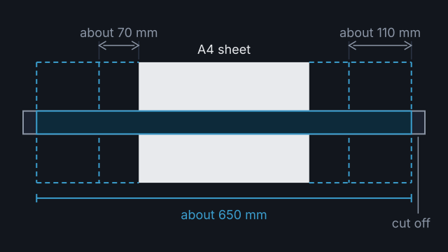
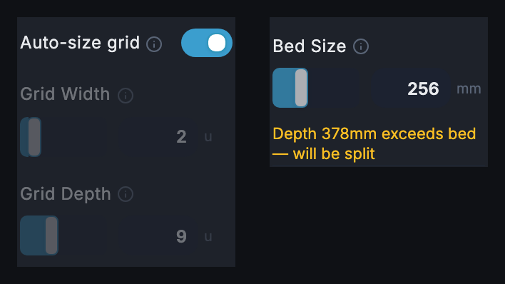

# Trace tools longer than the sheet

A saw, a level or a long spanner does not need to fit on the sheet. The sheet is there for scale, and a tool can hang over its edges. There is a limit, though: past it, the outline is cut off square and the pocket comes out short.

## 1. Know how far a tool can overhang

Except with Gemini, Tracefinity looks for tools on the sheet first. Where a tool runs off an edge, it searches a little further out on that side, twice, then stops. Centred along the sheet's long side and hanging off both ends, a tool can be a little over twice the sheet's length:

| Sheet | Longest tool |
|-|-|
| A4 | about 650 mm |
| Letter | about 610 mm |
| A3 | about 920 mm |
| Tabloid | about 950 mm |

Placement matters. Laid across an A4 sheet, the limit drops to about 520 mm. With the sheet under one end of the tool, it reaches only about 160 mm past the far edge of an A4 sheet.

Gemini is sent the whole straightened photo, so none of these limits apply to it.

## 2. Lay it out

1. Pick a sheet from the table that is long enough for the tool.
2. Lay the tool along the sheet's long side, centred, so it hangs off both ends by about the same amount.
3. Keep all four corners of the sheet clear of the tool.

A dark tool hanging off onto a dark surface can trace short: see [Trace shiny, chrome or black tools](shiny-or-dark-tools.md).

## 3. Take the photo

Stand back until the whole tool and all four corners of the sheet are in the frame, with a border round both. Hold the phone level above the middle of the tool. The sheet fills less of the frame than usual, which is fine at this size. With a 650 mm tool across most of the frame, each pixel covers about 0.4 mm.

## 4. Check the corners and the paper size

A tool crossing the sheet can throw off the automatic corner detection. Before you press **Continue**, check that each handle sits on a corner of the paper, and set **Paper Size** to the sheet you used.

## 5. Check both ends

After the trace, look at both ends of the outline. An end cut off straight across while the tool carries on in the photo means the tool was too long for that sheet or placement. Retake it on a bigger sheet. Or save the tool, measure it and drag that end out to length in the tool editor: see [Fix a trace that's slightly off](fix-a-trace.md).

## 6. Plan the bin

With **Auto-size grid** on, the bin grows to fit the tool. A 600 mm level needs a bin 15 units (630 mm) long. A bin can be up to 25 units along each side, with no more than 100 grid cells in all. The longest bin is 4 units wide and takes a tool of about 1040 mm. If a layout needs more, the editor says so and pauses the preview and export.

A bin longer than your printer bed is cut into pieces on export, unless it fits across the bed's diagonal. See [Print a bin bigger than your printer bed](bigger-than-your-bed.md).

## Common mistakes

- **Laying the tool across the sheet.** On A4 the limit drops from about 650 mm to about 520 mm.
- **Putting the sheet under one end.** The tool can reach only about 160 mm past the far edge of an A4 sheet.
- **Covering a corner of the sheet.** The handle has no corner to sit on. Keep all four clear.
- **Leaving Paper Size on A4 for an A3 sheet.** Everything traces 29% small.
