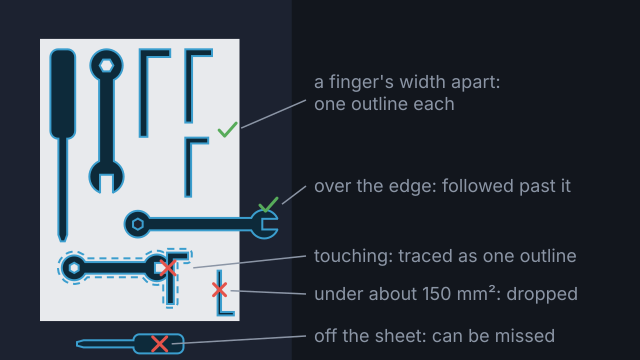
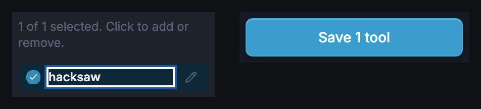

# Trace a whole set in one photo

A set of hex keys, screwdrivers or spanners can share one sheet and one trace. Tracefinity gives each tool its own outline, and you pick which to keep.

What goes wrong is tools touching. They come back as one outline, and the editor cannot split it.

## 1. Lay the set out

- Lay every tool flat, the way up you want it to sit in its pocket, with a clear gap round each one. A finger's width is plenty. Tools that touch or nearly touch trace as one outline.
- Keep the tools on the sheet. One can hang over an edge, but one lying fully off the sheet can be missed. [Longer tools](tools-longer-than-the-sheet.md) have their own guide.
- For a big set, use A3 or Tabloid paper. **Paper Size** starts on A4, so pick the size you used when you set the corners.
- Anything smaller than about 150 mm² seen from above is dropped as noise. This can include the smallest hex keys in a set. See [Trace small or thin tools](small-or-thin-tools.md).

## 2. Trace once

Set the corners and paper size, then click **Continue**. With several tracers, pick one on the Trace step and click **Trace Tools**. However many tools are on the sheet, one trace finds them all.

## 3. Choose and name the tools

Each tool comes back as its own outline, listed as tool 1, tool 2 and so on. Nothing is selected at first.

1. Click an outline to select it. Its row in the list gets a tick, and the save button counts up, for example **Save 3 tools**.
2. Click the pencil on a row to rename that tool, type the name and press Enter. Library search matches names, so name each tool now.
3. Leave out anything you do not want, like a stray shadow.
4. When every tool you want is ticked, click the save button.

Saving takes you to your library, and the app has no list of earlier photos to come back to. Select everything first. If you miss one, press your browser's Back button: the page reopens with every outline, without tracing again.

## 4. Put them in bins

Each tool is saved on its own, so the layout on the sheet is not kept. In a bin, click a tool in the library strip to add it, then drag it into place. [Plan a whole drawer](plan-a-drawer.md) covers spreading a set over several bins.

## Common mistakes

- **Tools touching.** They trace as one outline, which the editor cannot split. Space them out and take a new photo.
- **Saving before every tool is selected.** Press your browser's Back button to get back to the outlines.
- **Leaving the names as tool 1, tool 2.** Numbered tools are hard to find later. Rename them with the pencil, or later by clicking the name at the top of the tool editor.
- **Leaving Paper Size on A4 for a bigger sheet.** An A3 sheet traced as A4 comes out about 29% too small.
